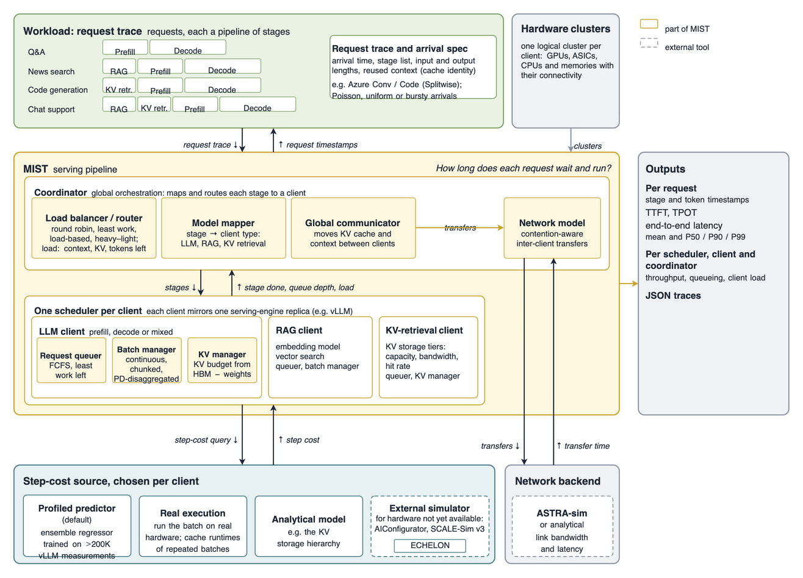

# MIST — Multi-stage AI Inference Simulation Toolkit

**MIST** is an event-driven simulator for co-designing LLM inference
systems: heterogeneous hardware, multi-stage request pipelines
(RAG, KV-cache retrieval, prefill, decode), batching policies and
prefill/decode (PD) disaggregation. It is the artifact for the SC 2026 paper
*"MIST: A Co-Design Framework for Heterogeneous, Multi-Stage LLM Inference."*

MIST answers questions like *"what TTFT/TPOT/throughput would this model get on
2×H100 prefill + 4×L40S decode under this trace?"* in seconds, without the
hardware. Per-step latencies come from either regressors trained on profiled
vLLM runs or the analytical
[ECHELON](https://github.com/astra-sim/GenZ-LLM-Analyzer) model (repository and
Python package still named GenZ).

Highlights from the paper:

- End-to-end latency within 6% of real deployed systems and of Splitwise-sim.
- Mean absolute error per stage: 4.2% prefill, 1.9% decode, 3.2% chunked
  prefill, 5.7% KV retrieval, 4.0% inter-client communication.
- The profiled step-cost predictor has 2.5% average error and runs 20–50×
  faster than real hardware.
- Case studies: under the paper's pricing and hardware assumptions,
  multi-vendor PD-disaggregated deployments give up to 49.3% more tokens/$
  than single-vendor PD disaggregation; KV storage co-design shows how the
  memory hierarchy shapes tail latency.

### Overview

MIST takes a request trace, where each request is a pipeline of stages. The
coordinator routes each stage to a client, and each client's scheduler batches
work and asks a step-cost source how long each batched step takes. Step costs
come from a predictor trained on profiled vLLM runs, real execution, an
analytical model, or an external simulator such as ECHELON for hardware that
does not exist yet.

<p align="center"></p>

*Dashed boxes are external tools.*

> **Status: research code.** The core simulation loop is tested and used for
> the paper, but APIs are not stable, some modules are experimental (see
> [Known limitations](#known-limitations)), and results from older, pre-release
> versions can differ — see [CHANGELOG.md](CHANGELOG.md).

## Install

Requires Python ≥ 3.10 and [Git LFS](https://git-lfs.com) (the profiled vLLM
runtime tables, ~220 MB, are stored in LFS).

```sh
git lfs install
git clone https://github.com/astra-sim/MIST.git
cd MIST
pip install -e ".[test]"
pytest            # ~10 s
```

This installs ECHELON (package `genz_llm`) from its GitHub repository; the
PyPI `genz_llm` release is too old for MIST.

If you only use the analytical `ClusterConfig`, you can skip the large tables
with `GIT_LFS_SKIP_SMUDGE=1 git clone ...` and later fetch what you need with
`git lfs pull --include "mist/Clusters/vllm_runtime_data/<file>.csv"`.

## Quickstart

```python
from mist import BatchingMethod, LengthVariables, ClusterConfig, PoissonDistribution, SchedulerConfig
from mist.Coordinator import MISTCoordinator
from mist.Client import ClientType, LLMClient

model = "meta-llama/meta-llama-3.1-8b"

# 4 req/s for 10 s; all times in MIST are milliseconds.
requests = PoissonDistribution(
    rps=4, sim_time=10_000, rand_seed=0,
    input_vars=LengthVariables(1024, 256),   # mean, std-dev
    output_vars=LengthVariables(128, 32),
).request_queue

coordinator = MISTCoordinator(requests, logging_file=None)
types = [ClientType.PREFILL, ClientType.DECODE]
coordinator.add_client(
    LLMClient(
        model=model,
        client_types=types,
        scheduler_config=SchedulerConfig(batching_method=BatchingMethod.CHUNKED, chunk_size=512),
        cluster=ClusterConfig(device="H100_GPU", tensor_parallel_size=1, model=model, bits="bf16"),
    ),
    types,
)
coordinator.run_sim()

stats = coordinator.get_global_stats()
print(f"TTFT {stats.TTFT:.1f} ms, TPOT {stats.TPOT:.1f} ms, {stats.output_throughput:.0f} output tok/s")
```

Pass `logging_file="trace.json"` to write a Chrome trace you can open in
`chrome://tracing` or [Perfetto](https://ui.perfetto.dev).

More in [`examples/`](examples):

| Script | Shows |
| --- | --- |
| `aggregated_serving.py` | One replica doing prefill + decode; chunked vs continuous batching |
| `disaggregated_prefill_decode.py` | Splitwise-style prefill/decode pools with KV transfer, replaying a trace |
| `kv_cache_retrieval.py` | A cache-retrieval stage loading prefix KV from a DRAM/SSD hierarchy |

## Architecture

The paper describes MIST in three layers: the **AI Workload
layer** (request traces, each request a pipeline of stages), the **System &
Software layer** (a coordinator plus one scheduler per client) and the
**Hardware layer** (one logical cluster per client, costed by a step-cost
source). The code uses the paper's names:

| Paper term | Code |
| --- | --- |
| Coordinator (load balancer, model mapper, global communicator) | `mist.Coordinator` (`MISTCoordinator`, `global_router`) |
| Stage-Push / Client-Step events | `EventType.STAGE_PUSH` / `EventType.CLIENT_STEP` |
| Client: LLM client, KV client, RAG client | `mist.Client`: `LLMClient`, `KVRetrievalClient`, `RAGClient` |
| Scheduler (request queuer, batch manager, KV manager) | `mist.Scheduler` |
| HW cluster and its runtime method (empirical, analytical, external simulator) | `mist.Clusters`: `vLLMClusterConfig`, `ClusterConfig` (ECHELON), `TraceClusterConfig`, `MemoryCacheConfig` |
| Inter-client network model | `mist.Global_Network` |

Code from versions before 0.2 used *Engine* for client and *Platform* for
cluster (`mist.Engine`, `LLMEngine`, `PlatformConfig`, `engine_types=`,
`platform=`, `coordinator.add_engine`, ...). These names still work for one
release and emit a `DeprecationWarning`; see [CHANGELOG.md](CHANGELOG.md).

```
 Coordinator   event loop (heap of STAGE_PUSH / CLIENT_STEP events),
     │         request routing, inter-client KV transfer cost
     ▼
 Client        one model instance: LLMClient (prefill/decode),
     │         KVRetrievalClient, RAGClient, host
     ▼
 Scheduler     per-client batching, adapted from vLLM: token / batch-size /
     │         KV budgets; STATIC, CONTINUOUS, MIXED, CHUNKED, DISAGGREGATED
     ▼
 Cluster       cost model: how long a batch takes
               ClusterConfig        analytical (ECHELON)
               vLLMClusterConfig    RandomForest over profiled vLLM step times
               TraceClusterConfig   interpolated performance traces
               MemoryCacheConfig    tiered KV-cache retrieval
```

| Package | Contents |
| --- | --- |
| `mist.Coordinator` | `MISTCoordinator`, `MISTCoordinatorDisagg` (Splitwise), `MISTCoordinatorDisagg_DistServe`, routers |
| `mist.Client` | `MISTClient` base, `LLMClient`, `KVRetrievalClient`, `ClientMetrics` |
| `mist.Scheduler` | `Scheduler`, `SchedulerConfig`, `BatchingMethod` |
| `mist.Clusters` | cost models above; bundled vLLM profiles in `Clusters/vllm_runtime_data/` |
| `mist.Request`, `mist.Input_requests` | request lifecycle; Uniform/Poisson/Normal/Bursty generators, trace replay |
| `mist.Global_Network` | GPU interconnect specs for transfer cost |
| `mist.Tracing` | Chrome trace JSON writer |

### Things worth knowing

- **Units:** all times are milliseconds, including replayed trace arrivals.
- **Precision:** `ClusterConfig(bits=...)` defaults to `"bf16"`. Set it to what
  the deployment actually runs (`"fp8"`, `"int8"`, ...).
- **Latency cache:** `ClusterConfig` keeps computed step latencies in
  `~/.cache/mist` (override with `MIST_CACHE_DIR`) and reuses the nearest entry
  within a tolerance. Delete the directory for a cold, bit-reproducible run.
- **Reproducibility:** every request generator takes `rand_seed` and uses its
  own RNG, so parallel sweeps are safe.
- **Logging:** diagnostics go through the standard `logging` module under the
  `mist` logger, e.g. `logging.getLogger("mist").setLevel(logging.DEBUG)`.

## Reproducing the paper

Paper figures and tables are produced by
[MIST-Simulator/SC_Paper_Charts](https://github.com/MIST-Simulator/SC_Paper_Charts),
which installs this package.

## Known limitations

- **Paper features not in this release.** The paper also describes
  speculative decoding with an EAGLE-style draft stage, 3- and 4-way
  disaggregation, and ASTRA-sim as the inter-client network backend. This
  repository does not include them yet; inter-client transfers use the
  analytical link model in `mist.Global_Network`.
- **GenZ version skew.** Current GenZ `db.py` refers to `*QuantMode.bfloat16`
  names that its vendored `aiconfigurator` renamed; constructing an ECHELON
  `NPU` for the profiled-ops devices (`h100_sxm`, `tpu_v6e`, ...) raises
  `AttributeError` until that is fixed upstream. The table-driven devices
  (`H100_GPU`, `A100_40GB_GPU`, `L40S`, ...) are unaffected.
- **Latency cache history.** Because the cache matches within a tolerance,
  results can differ in the last few significant digits between a cold and a
  warm cache.
- **Over-long prompts with non-chunked batching.** A prompt longer than
  `max_num_batched_tokens` is never scheduled and blocks the head of the
  waiting queue. Use `CHUNKED` batching or raise the budget.
- The scheduler has no preemption. Requests whose KV cache can never fit on
  their client are dropped (`FINISHED_IGNORED`) and are not counted as served.
- `vLLMClusterConfig` falls back to the analytical model outside the profiled
  (model, GPU, TP) combinations and warns when it does.
- The RAG client and the DistServe coordinator see far less use than the rest
  of the code; treat their results as experimental.

## Citation

If you use MIST, please cite the SC 2026 paper:

```bibtex
@inproceedings{mist_sc26,
  title     = {{MIST}: A Co-Design Framework for Heterogeneous,
               Multi-Stage {LLM} Inference},
  author    = {Bambhaniya, Abhimanyu Rajeshkumar and Wu, Hanjiang and
               Subramanian, Suvinay and Srinivasan, Sudarshan and
               Kundu, Souvik and Yazdanbakhsh, Amir and
               Elavazhagan, Midhilesh and Kumar, Madhu and Yu, Minlan and
               Raychowdhury, Arijit and Krishna, Tushar},
  booktitle = {Proceedings of the International Conference for High
               Performance Computing, Networking, Storage and Analysis
               (SC '26)},
  address   = {Chicago, IL, USA},
  year      = {2026}
}
```

If you use the analytical step-cost backend, also cite ECHELON:

```bibtex
@inproceedings{echelon_iccad26,
  title     = {Analyzing the Impact of Emerging Technology on {AI} Datacenter
               Serving Distributed {LLM} Inference using {ECHELON}},
  author    = {Bambhaniya, Abhimanyu Rajeshkumar and Raj, Ritik and
               Jeong, Geonhwa and Kundu, Souvik and Srinivasan, Sudarshan and
               Subramanian, Suvinay and Elavazhagan, Midhilesh and
               Kumar, Madhu and Krishna, Tushar},
  booktitle = {IEEE/ACM International Conference on Computer-Aided Design
               (ICCAD '26)},
  address   = {San Jose, CA, USA},
  year      = {2026},
  doi       = {10.1145/3831252.3834151}
}
```

## License

MIT — see [LICENSE](LICENSE). Contributions welcome, see
[CONTRIBUTING.md](CONTRIBUTING.md).
